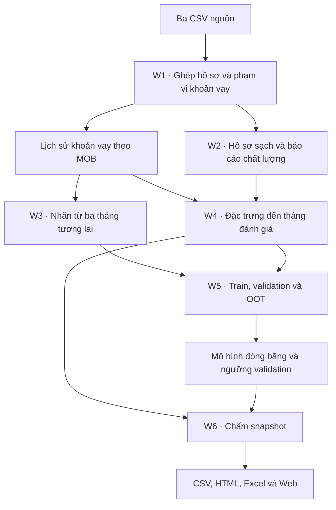

# Kiến trúc và kịch bản bảo vệ đồ án

## Theo một khoản vay qua hệ thống

| Đọc file | Câu hỏi cần trả lời | Tự kiểm tra |
|---|---|---|
| `data_check.py` | Tại sao hiệu số số hồ sơ và số khoản vay đủ điều kiện lớn? | Tách hồ sơ chưa có performance, mã không khớp, phê duyệt và nhóm loại theo phạm vi. Xem `source_inventory.csv`. |
| `clean_rules.py` | Khi nào giá trị trống được giữ, khi nào được điền? | Xem cờ missing và quy tắc thu nhập. Median của các pipeline cần impute được fit trong Train. |
| `build_panel.py` | Tại MOB 3, nhãn nhìn vào MOB nào? | MOB 4–6. Có sự kiện quan sát sớm thì giữ nhãn 1 trong panel. Train/validation/OOT yêu cầu đủ follow-up theo phương pháp bàn giao. |
| `features.py` | Cửa sổ 3 tháng tại MOB 3 nhìn vào DPD nào? | MOB 1–3. Sửa DPD MOB 5 và kiểm tra lại feature tại MOB 3. |
| `train_model.py` | Tại sao không random split từng snapshot? | Cùng khoản vay có nhiều tháng. Tách theo cohort và áp ranh giới trưởng thành nhãn giúp tránh chồng dữ liệu tương lai vào validation/OOT. |
| `thresholds.py` | Vì sao Red thấp hơn 3% trong OOT? | 3% là mục tiêu công suất validation. Ngưỡng PD cố định, phân phối điểm tháng sau có thể khác. |
| `pipeline.py`, `artifacts.py` | Làm sao chứng minh các file thuộc một lượt? | So mã lượt, tháng và manifest. Thư mục kết quả chỉ xuất hiện sau khi báo cáo hoàn tất. |
| `scoring.py`, `serve_ews.py`, `web/` | Chọn tháng trên web có train lại không? | Chấm bằng mô hình đóng băng trên feature đến tháng đó. CSV tải từ web theo cùng bộ lọc của danh sách. |
| `workbook.py`, `report.py` | Vì sao mẫu Excel có ít dòng hơn CSV? | Excel hiển thị tối đa 80 khoản mỗi mức. KPI toàn danh mục dùng tất cả khoản vay. DPD tương lai được che ở sheet raw. |

## Cấu trúc sử dụng

| Thư mục | Nội dung và cách dùng |
|---|---|
| `data/raw` | Ba CSV nguồn. SHA-256 liên kết chúng với lượt huấn luyện. |
| `data/interim` | Vùng phân tích W2 và ví dụ dạy W3–W4. Lệnh `python tools/make_dummy_data.py` tạo 6 hồ sơ tổng hợp với ca 30+, 90+, đã quá hạn, đóng sớm và thiếu dữ liệu. |
| `src/ews` | Quy tắc nghiệp vụ, mô hình, dịch vụ chấm và xuất báo cáo. |
| `web` | Danh mục, kiểm định và chất lượng dữ liệu, dùng API chạy tại máy cá nhân. |
| `outputs` | Bộ bàn giao đã huấn luyện. Lưu những lượt sau trong thư mục kết quả mới. |
| `tests`, `tools` | Kiểm thử thời điểm, nhãn, ngưỡng, công bố kết quả và đối chiếu các định dạng. |
| `docs` | Phương pháp, kết quả, tài liệu W1–W6, runbook và workbook khung gốc. |

## Kịch bản demo 6 phút

| Thời lượng | Thao tác trên màn hình | Lời trình bày |
|---|---|---|
| 0:00–0:40 | Mở danh mục tháng 06/2025 | “Ở mỗi tháng, nhóm xếp thứ tự rà soát các khoản đang dưới 30 DPD theo khả năng chạm 30 DPD trong ba tháng tới.” |
| 0:40–1:50 | Lọc Red, mở một khoản, đọc DPD, PD, tín hiệu và hành động. Tải CSV theo bộ lọc. | “DPD cho biết tình trạng hôm nay. PD giúp sắp thứ tự rà soát theo rủi ro ba tháng tới. Tín hiệu là quan sát từ lịch sử trả nợ, hành động là đề xuất nghiệp vụ.” |
| 1:50–2:25 | Chọn Existing 30+. | “Khoản đã chạm ngưỡng chuyển thẳng sang luồng quản lý quá hạn. Vì vậy cột PD 30+ ở đây để trống.” |
| 2:25–3:20 | Chuyển tháng 09/2024. Đối chiếu tổng và số Red với bộ CSV/Excel cùng tháng nếu đã xuất sẵn. | “Tháng đánh giá thay đổi dữ liệu được nhìn thấy. Mô hình và ngưỡng thuộc cùng mã lượt.” |
| 3:20–4:30 | Mở Kiểm định và chỉ AP so baseline, rồi chỉ biểu đồ PD đối chiếu thực tế. | “AP 30+ tăng từ 0,3417 lên 0,4352. PD bình quân 2,58% cao hơn tỷ lệ quan sát 1,29%. Kết quả hiện tại hỗ trợ ưu tiên rà soát và cho thấy khoảng lệch hiệu chỉnh.” |
| 4:30–5:30 | Mở Chất lượng dữ liệu rồi chỉ một dòng của ví dụ tổng hợp. | “Tại MOB 3, feature dùng đến MOB 3, còn target nhìn MOB 4–6. Đó là ranh giới giữa thông tin có lúc chấm và kết quả chỉ quan sát về sau.” |
| 5:30–6:00 | Mở Excel Overview và file `run_summary.json`. | “Có thể đối chiếu tháng, mã lượt và số khoản theo cấp qua các đầu ra.” |

Chuẩn bị web và mở sẵn HTML/Excel trước giờ demo. Nếu web gặp trục trặc, dùng HTML để lọc tháng bàn giao và dùng Excel để trình bày nguồn, nhãn, ngưỡng và backtest.

## Phạm vi diễn giải

- Validation của bộ dữ liệu bàn giao chỉ có một tháng sau khi áp ranh giới thời gian. Ngưỡng có thể nhạy theo phân phối của tháng đó.
- AP và capture tính theo snapshot, nên một khoản có thể đóng góp nhiều tháng. Đọc cùng quy mô tập, tỷ lệ dương và phạm vi DPD.
- 90+ là mục tiêu kiểm định riêng. Dashboard danh mục dùng scorer 30+.
- Fingerprint cho biết tính nhất quán của dữ liệu và kết quả local. Chỉ mở joblib do nhóm tạo hoặc được cung cấp qua nguồn tin cậy.
